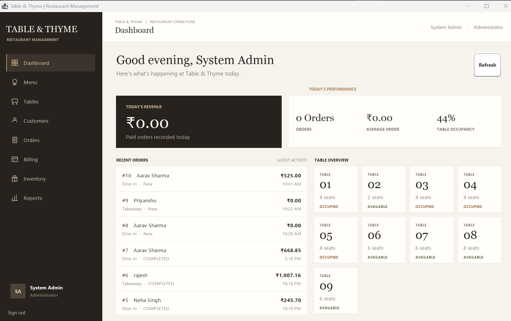
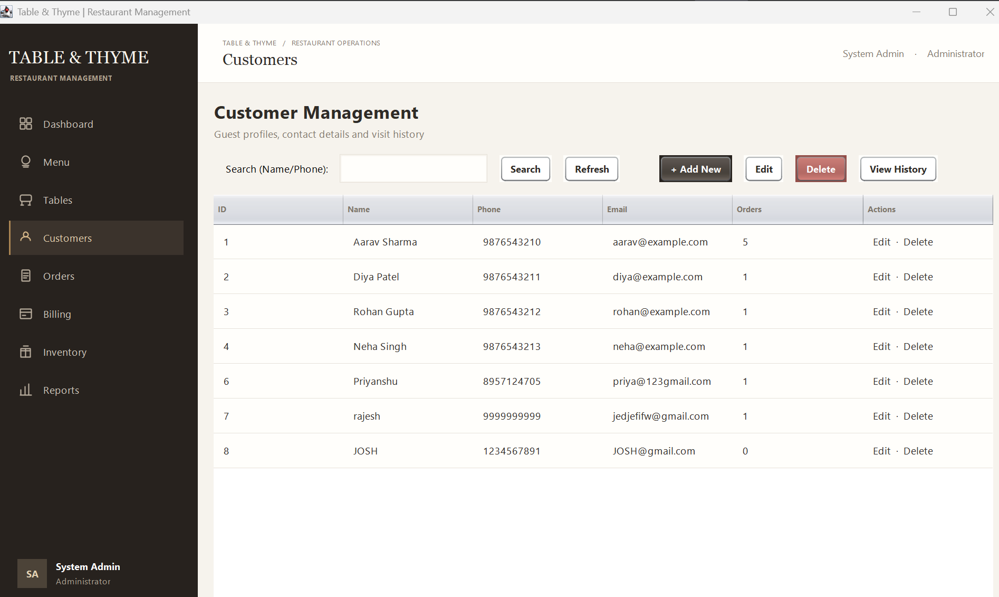
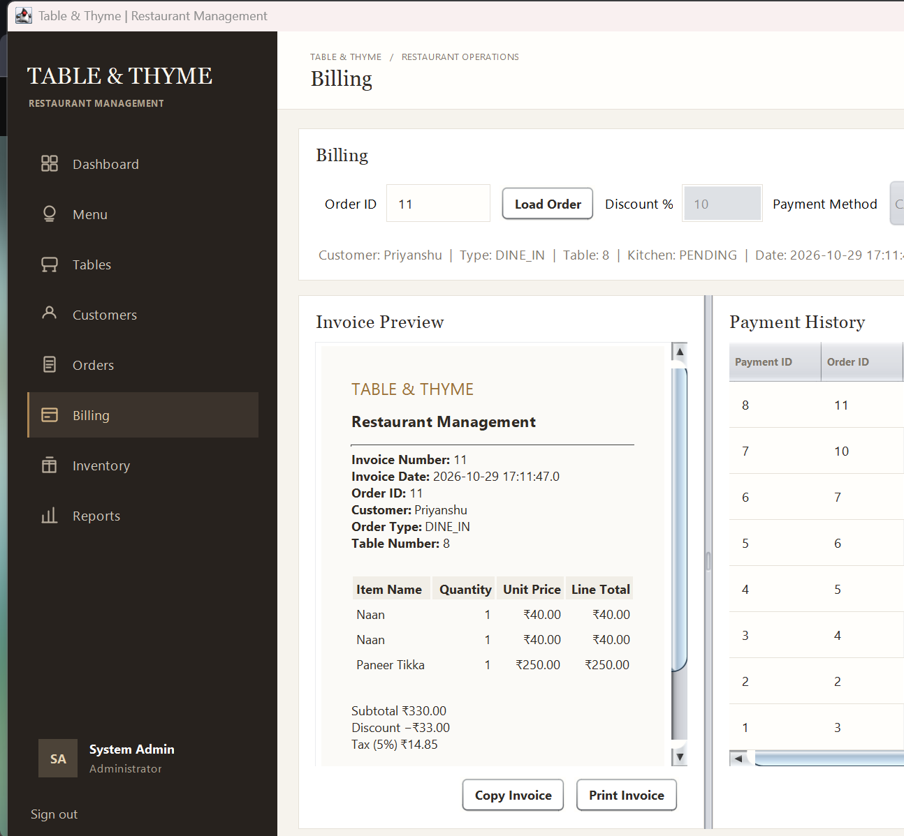
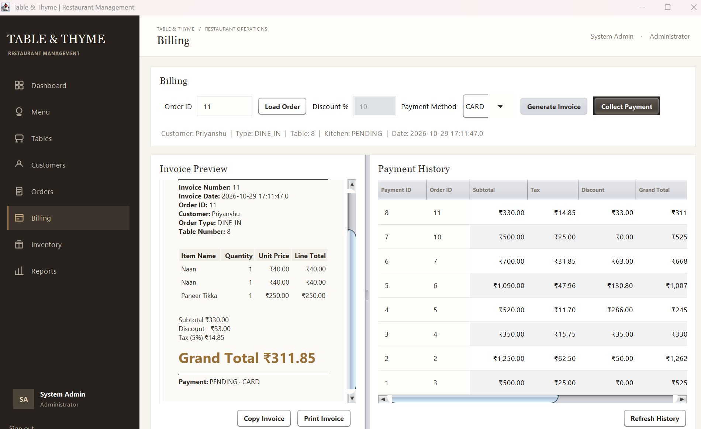

# 🍽️ Table & Thyme — Restaurant Management System

A desktop-based restaurant management application built using **Java Swing, JDBC, and MySQL**. It streamlines restaurant operations through a unified interface for managing menus, tables, customers, orders, billing, inventory, and sales reports.


---

## 📌 Overview

**Table & Thyme** is designed to simplify day-to-day restaurant management. It provides a centralized desktop interface for restaurant staff and administrators to manage operational data and process orders.

The application follows a layered architecture using models, Data Access Objects (DAOs), services, and Swing-based user interfaces.

## ✨ Features

* **Authentication:** Login system with administrator and staff roles.
* **Dashboard:** View restaurant activity, revenue metrics, recent orders, and table occupancy.
* **Menu Management:** Manage menu items, categories, prices, and availability.
* **Table Management:** Manage restaurant tables, seating capacity, and occupancy status.
* **Customer Management:** Maintain customer profiles and contact information.
* **Order Management:** Create orders, add menu items, calculate totals, and track order status.
* **Billing & Payments:** Generate invoice previews, apply discounts, calculate tax, and record payments.
* **Inventory Management:** Track stock quantities and identify low-stock items.
* **Reports:** Access restaurant sales and operational summaries.

*Feature availability and behaviour depend on the current implementation.*

## 🛠️ Technology Stack

| Technology | Purpose                          |
| ---------- | -------------------------------- |
| Java 21    | Application logic                |
| Java Swing | Desktop graphical user interface |
| JDBC       | Database connectivity            |
| MySQL 8.4  | Relational database              |
| Maven      | Dependency and build management  |
| JUnit      | Automated unit testing           |

## 🏗️ Project Architecture

The application separates responsibilities into different layers:

```text
Table & Thyme
│
├── src/main/java/restaurant
│   ├── config/       # Database configuration
│   ├── dao/          # Database access operations
│   ├── model/        # Application data models
│   ├── service/      # Business logic
│   ├── ui/           # Swing screens and panels
│   └── util/         # Validation and utility classes
│
├── src/test/java/    # Automated tests
├── database/         # Database schema and setup SQL
├── pom.xml           # Maven configuration
└── .gitignore
```

## ⚙️ Prerequisites

Install the following before running the application:

* JDK 21
* Apache Maven
* MySQL Server 8.4 or a compatible MySQL version
* Git (optional, for cloning the repository)

Verify Java and Maven:

```bash
java -version
mvn -version
```

## 🚀 Installation & Setup

### 1. Clone the repository

```bash
git clone https://github.com/priyanshu-a01y/table-and-thyme.git
cd table-and-thyme
```

### 2. Create the database

Open MySQL and execute the project's database setup script:

```sql
SOURCE database/restaurant_management.sql;
```

Run this command from the MySQL client after adjusting the file path for your local system.

**Important:** Review the SQL script before executing it. Back up any existing database before running scripts that create, modify, or seed tables.

### 3. Configure database credentials

Create a local `db.properties` file in the project root if required by the application's database configuration.

Use your own local MySQL credentials. For example:

```properties
db.url=jdbc:mysql://localhost:3306/restaurant_management
db.username=YOUR_MYSQL_USERNAME
db.password=YOUR_MYSQL_PASSWORD
```

Check `DatabaseConnection.java` and the project's configuration code to confirm the exact property names expected by the current implementation.

**Never commit real passwords or private credentials to GitHub.**

### 4. Build the application

```bash
mvn clean package
```

### 5. Run the application

```bash
mvn exec:java
```

The application requires a running MySQL server and valid database configuration.

## 🧪 Testing

Run the automated tests with:

```bash
mvn test
```

Build the application and execute tests with:

```bash
mvn clean package
```

## 🔐 Security Notes

* Configure database credentials locally.
* Do not commit passwords, API keys, or private configuration files.
* Use appropriate database permissions.
* Review authentication and role-based access controls before production use.

## 🔮 Future Improvements

Potential enhancements include:

* Windows installer with bundled Java runtime
* Improved invoice printing and PDF export
* Enhanced sales analytics and report export
* Better input validation and error handling
* Additional automated integration tests
* Deployment and database setup documentation

## 📸 Application Screenshots

### Dashboard


### Customer Management


### Billing


### Billing and Payments


## 👨‍💻 Author

**Priyanshu**

GitHub: [@priyanshu-a01y](https://github.com/priyanshu-a01y)

## 📄 License

No license has been specified yet. Unless a license is added, the repository's code is not automatically granted an open-source license for reuse or redistribution.

---

<p align="center">
  <strong>Table & Thyme</strong><br>
  Thoughtful technology for smoother restaurant operations.
</p>
